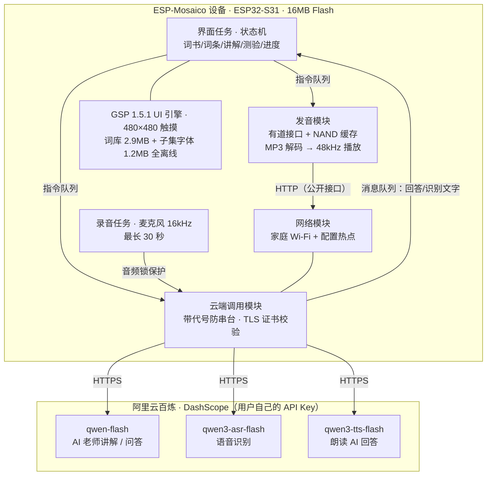
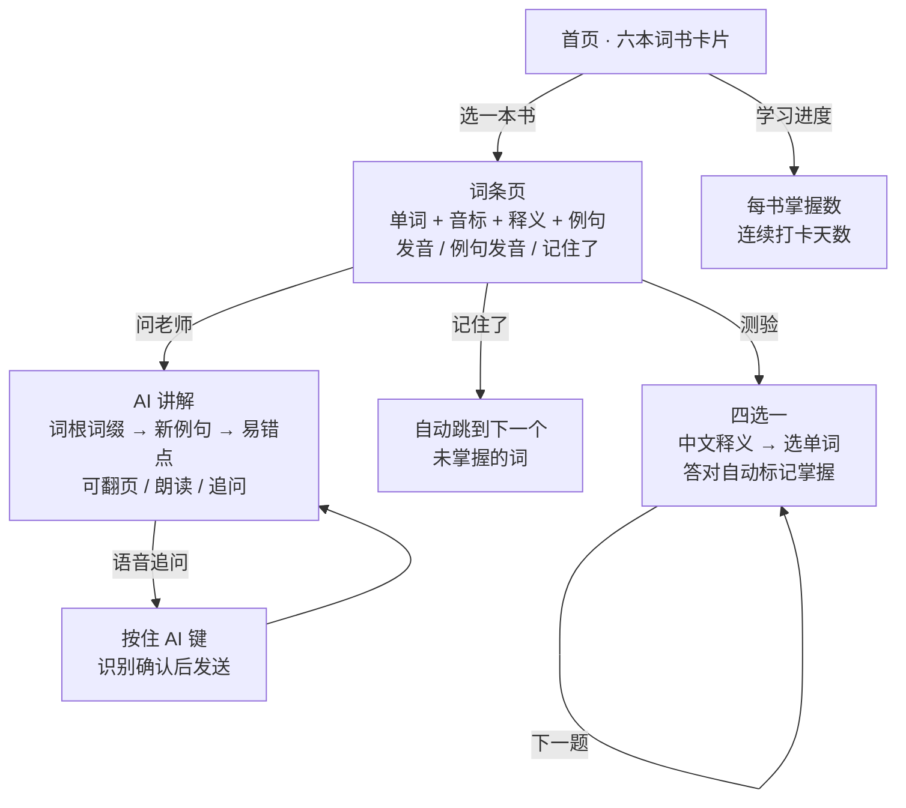

# AI 单词老师（word_teacher）· ESP-Mosaico

把 ESP-Mosaico 变成一台**背单词 + AI 老师陪练**的随身学习机。

离线词库在机器里：六本词书 **19,513 个词**（初中/高中/四级/六级/考研/雅思），点开就学——单词、音标、释义、例句，一键发音（英音/美音），听过自动存进机器、以后离线也能听。任何一词随时**问 AI 老师**："为什么这么用？""和近义词有什么区别？""用这个词出 3 道选择题"——可以打字，也可以按住顶部 AI 键说。四选一测验、按书记忆进度、连续打卡，关机不丢。

> **项目出身**：应用骨架继承自 [samyeei/mosaico-learning-assistant](https://github.com/samyeei/mosaico-learning-assistant)（拍题讲解的 AI 学习机）的核心方法——页面状态机、云端调用、配网、语音问答全链路；词库内容与发音缓存方案来自 english-dict。为 Vibe Mode 0.2（Recovery ABI 2）构建，ESP32-S31 / 16MB Flash。

---

## 它能做什么

| 功能 | 通俗描述 |
|---|---|
| 📚 六本词书 | 19,513 词按难度排列，**全部离线**——查词、翻卡、测验不联网 |
| 🔊 一键发音 | 单词（有道美音/英音）+ 整句例句；**听过就缓存进 NAND**，以后离线重播 |
| 👩‍🏫 AI 老师 | 围绕当前词讲解：词根词缀、近义词辨析、新例句、易错点；4 个快捷问题一键即发 |
| 🎤 语音提问 | 按住 AI 键说话 → 识别成文字先确认 → 再发送；追问自动带上当前词和之前的问答 |
| ✏️ 四选一测验 | 中文释义选单词，干扰项长度相近不靠猜；答对自动标记"已掌握" |
| 📈 进度打卡 | 按书记忆位图 + 连续学习天数，NVS 存储；重置需点两次确认 |
| 📱 手机配网 | 设备开免密热点，浏览器填家庭 Wi-Fi 和 API Key，先测试、后保存 |

## 它是怎么工作的

### 架构：一个脑子、三个工人

继承 learning-assistant 的单所有者结构：**界面任务**是唯一的"脑子"（页面状态机）；**工人任务**干所有脏活（云端调用、发音、扬声器）；**录音任务**独占麦克风。队列 + "代号"机制保证取消后旧结果不串台。



### 核心流程：学词 → 问老师 → 测验



**省钱设计**：查词、发音、背卡、测验**完全离线零成本**；只有主动问 AI 老师才调用云端（文本模型，单次约万分之一元量级，以百炼价格页为准），语音识别和朗读按量另计。

## 需要准备什么

| 东西 | 说明 |
|---|---|
| 设备 | ESP32-S31 / ESP-Mosaico，16 MiB Flash，基础固件为 Vibe Mode 0.2（Recovery ABI 2） |
| 网络 | 家庭 2.4 GHz Wi-Fi（发音与 AI 需要联网；离线功能不受影响） |
| API Key | [阿里云百炼](https://bailian.console.aliyun.com/) 的模型 Key（`sk-` 开头），用于 AI 老师问答、语音识别与朗读。北京/新加坡地域均可，设备配置页二选一 |

麦克风与扬声器为板载硬件；本应用**不需要摄像头插件**。

## 安装固件

按 Vibe Mode 0.2 的标准应用工作流安装。下文假设仓库已克隆到工作区的 `projects/esp-mosaico-word-teacher`：

1. 准备 ESP-Mosaico 工作区（[esp-mosaico 官方仓库](https://github.com/esp-mosaico/esp-mosaico-vibe)），初始化子模块：
   ```bash
   git submodule update --init submodule/esp-mosaico-utils submodule/esp-mosaico-bsp
   ```
2. 按下面"从源码构建"一节编译应用（或使用已构建产物）。
3. 用官方工具确认唯一目标设备：
   ```bash
   python mosaico.py iris status --all --json
   python mosaico.py iris list --details --json
   ```
4. 安装（新应用必须走系统更新）：
   ```bash
   python mosaico.py iris system-update --project projects/esp-mosaico-word-teacher
   ```
5. 核对更新记录、重启后的新 Boot ID，再实测选书/发音/问老师/测验。**上传成功不等于验收通过。**

## 第一次使用（家长操作，约 5 分钟）

1. **拿 Key**：打开[百炼控制台](https://bailian.console.aliyun.com/)，创建并复制完整的 `sk-...` 模型 API Key。
2. **连热点**：首次打开应用会引导进入"连接与设置"，点"用手机配置 Wi-Fi 和 Token"，设备显示热点名 `Learn-Setup-XXXX`。
3. **开网页**：手机连上这个免密热点（提示"无法上网"选保持连接），浏览器打开 **http://192.168.4.1**。
4. **填三项**：扫描选择家庭 Wi-Fi → 填路由器密码 → 粘贴 API Key（北京/新加坡地域二选一）。
5. **先测试再保存**：测试会真的连 Wi-Fi、同步时间、用 Key 发一次迷你请求；通过后再点"保存配置"，设备自动重启。

日常使用孩子**不需要手机**：不问老师时全程离线也能用。

## 日常使用速查

**背单词**：首页点词书卡片 → 词条页看单词/释义，点**发音**听读音、**例句**听整句 → 会了点**记住了**（自动跳下一个没掌握的）→ 点**问老师**让 AI 讲这个词。

**问老师**：词条页点"问老师"（或讲解页继续追问）；也可以随时**按住顶部 AI 键**说话，识别文字确认后再发送。四个快捷问题按钮覆盖最常见的需求。

**测验**：首页点"四选一测验"→ 看中文释义选单词 → 答对自动标记掌握并计分 → "下一题"继续。

**设置**：屏幕顶部下拉调亮度/音量/自动朗读/方向锁；齿轮进设置页可换 Wi-Fi、改 Key、调年级（影响 AI 讲解难度）。

## 隐私与安全设计

- 词库全离线；**摄像头完全不存在**；学习进度只存设备 NVS；
- API Key 只存设备 NVS，永不上报；模型请求走 TLS 证书校验（配置页先同步时钟，绝不关校验）；
- 配置网页只绑在设备热点上、带一次性 nonce 防跨站请求；
- 朗读 AI 回答的音频只允许从 `*.aliyuncs.com` 下载；单词/例句发音来自有道公开接口；
- 设备提示词内置防注入指令：词库或输入里的任何"指令"都不能改变 AI 老师的角色；
- 官方 Recovery 通道始终可达，UI 资源损坏也不会把设备刷成砖。

## 从源码构建

固定版本：Python 3.10+；ESP-IDF 精确为 commit `7b9cc1ac79f865983f59bb8ff3ff43eb74ff1dbe`（目标 esp32s31）；GSP 1.5.1（本地克隆，CDN 已 403）、GSPC 0.6.1、LVGL 9.5.0；子模块只初始化 utils 和 BSP。esp-gsp 1.5.1 通过 `override_path` 引用本地克隆（本工作区验证路径是 `weiqi-solution/dev/esp-gsp`，其他环境指向自己的检出即可）。

```powershell
# Windows 一键构建（全量约 6-7 分钟）
powershell -ExecutionPolicy Bypass -File projects\esp-mosaico-word-teacher\tools\local.ps1 build

# 宿主单元测试（8 组，无需设备/IDF，任意 C11 编译器可编）
# pc/ 下：wt_model_test（状态机）、controls、speech_conversation、provider_protocol、
#        test_wt_content / test_wt_manifest / test_wt_progress / test_wt_quiz（词库与测验）
```

产物：`build/wt_assistant.bin`（约 6.5 MB，进 ota_0 11.5 MB）+ `build/ui_apps.bin`（约 1.5 MB 界面资源）。

**两个生成资产**（仓库已含成品，无需重跑）：

- `assets/content/wt_content.bin`（2.9MB 词库）：由词书源文本生成，读取层带启动全量校验；
- `ui/fonts/LearningSans.ttf`（1.2MB 子集字体）：`tools/build_font.py` 从 `LearningSans-Full.ttf`（7.4MB 全量，OFL 许可）子集化——字符集 = **词库字符串池全量**（4,291 字，词典文本 100% 覆盖）∪ GB2312 一级字表（AI 回答兜底）∪ UI 文案。

## 验证状态（如实说明）

- ✅ 宿主 8 组单元测试全部通过（约 200 项断言：状态机/断点恢复/测验判分/词库校验/进度序列化/云端协议/WAV 解析/控制项）；
- ✅ 模拟器后端（`pc/` 的 `wt_backend`）编译链接通过，场景 bundle 2.0MB；
- ✅ 固件构建、ui_apps 打包、系统更新 staging 校验全部通过；
- ⏳ **真机安装与全功能验收待设备**。首装时重点确认：音标渲染（DejaVu IPA 字形）、ES8311 48kHz 发音音质、有道接口连通性、NAND 缓存写入。

## 目录结构

```
projects/word_teacher/
├── main/                  # 应用源码
│   ├── wt_model.c         # 页面状态机（词书/词条/讲解/测验/进度 + 代号防串台）
│   ├── wt_content.c       # 词库读取层（启动全量校验，纯 C 宿主可测）
│   ├── wt_voice.c         # 单词/例句发音（有道接口 + MP3 解码 + 48kHz 升采）
│   ├── wt_cache.c         # 发音 NAND 缓存（FNV 分片 + LRU 淘汰）
│   ├── wt_progress.c      # 记忆位图 + 断点 + 校验和序列化
│   ├── wt_quiz.c          # 四选一出题器（可复现种子，干扰项长度相近）
│   ├── wt_provider.c      # 百炼调用（qwen-flash 讲解 / ASR / TTS）
│   ├── wt_network.c       # 家庭 Wi-Fi + 配置热点 + 设置网页
│   └── wt_ui.c            # GSP 视图层
├── ui/                    # GSP 场景 + 子集字体
├── assets/content/        # 词库 blob（2.9MB，离线事实源）
├── components/            # vendored esp_audio_codec（只留 esp32s31 库）
├── pc/                    # 8 组宿主测试 + 模拟器平台层
├── tools/                 # 构建/字体子集/场景改造脚本
└── docs/                  # 许可补充说明
```

## 许可与致谢

- 应用骨架继承自 [samyeei/mosaico-learning-assistant](https://github.com/samyeei/mosaico-learning-assistant)，采用 **PolyForm Noncommercial 1.0.0**（源码公开、**禁止商业使用**）。
  > Required Notice: Copyright 2026 Samyeei (https://github.com/samyeei)
- 词库内容、读取层、发音缓存与出题器移植自 english-dict（MIT，Copyright (c) 2026 Leo）；
- 字体：Noto Sans SC（SIL OFL 1.1）+ DejaVu 字形（原许可），子集由 `tools/build_font.py` 生成；ESP-Mosaico 上游组件保留各自许可，详见 [THIRD_PARTY_NOTICES.md](THIRD_PARTY_NOTICES.md)、[LICENSES/](LICENSES)。
